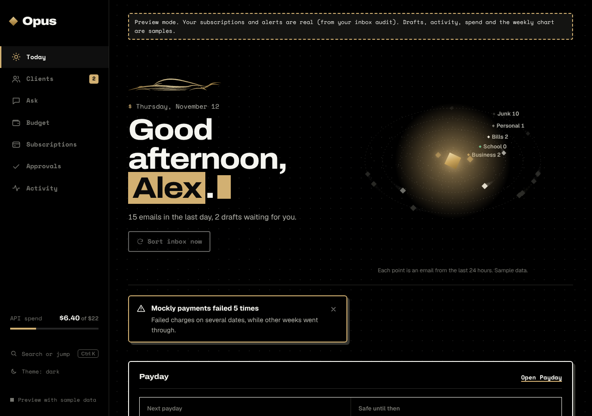

# Opus

A personal assistant for your inbox and subscriptions, powered by Claude.

**What it does (v1):** sorts your Gmail (business / school / bills / personal / junk), flags what needs a reply, writes draft replies into Gmail Drafts, tracks subscriptions, and suggests what to cancel. A dashboard shows all of it.

An **Ask** page lets you chat with it: search your inbox or the web, or have it draft a reply.

**What it can never do:** send, delete, trash, label or cancel anything. There is no code path for it. `npm run safety` checks this.

## Try it in 2 minutes (no keys)
```
cd agent && npm install && npm run demo      # fake inbox, fake model
npm run seed:mock && npm run serve:mock         # then open http://127.0.0.1:8787
cd ../dashboard && npm install && npm run build   # first time only, before serve
```
The dashboard also runs on its own with sample data (`npm run dev` in `dashboard/`).

## Go live
See `docs/SETUP.md`. In short: Anthropic API key (set a Console spend limit), Google OAuth (`npm run auth`), optional Telegram bot, then `npm run serve` with `AUTORUN=1`.

## Run it on a server
`docker compose up -d --build` runs Opus behind Tailscale, with no port open to the internet. `npm run check:deploy` enforces that. See [docs/DEPLOY.md](docs/DEPLOY.md), which also lists what has and has not been tested.

## Approval queue
Anything with consequences waits in the queue for you. Approving only makes Opus write the steps; it never cancels or sends for you. Keys: `j`/`k` move, `a` approve, `d` not now, `u` undo, `Enter` details. See [docs/approval-queue.md](docs/approval-queue.md).

## Cost
Target low $20s a month; alert at $100 (Telegram/console). Per-run cap $0.25, hard stop at $100. Triage uses Haiku, drafts use Sonnet, bulk senders are sorted by rules for free.

## Design
Opus keeps its original gold, black and paper palette, with a few pieces borrowed from the NitroDrp design: dot-grid ground, `$` terminal eyebrows, a marked headline phrase, mono labels and hard offset shadows. See [docs/design/opus-style.md](docs/design/opus-style.md).



## Layout
- `agent/` the agent, API server, SQLite. `src/tools.ts` is the complete list of what the model may do.
- `dashboard/` React + Vite UI. `shared/audit.json` is sample data; your own setup goes in `seed/` (see `docs/SETUP.md`).

## License
MIT. See [LICENSE](LICENSE).
