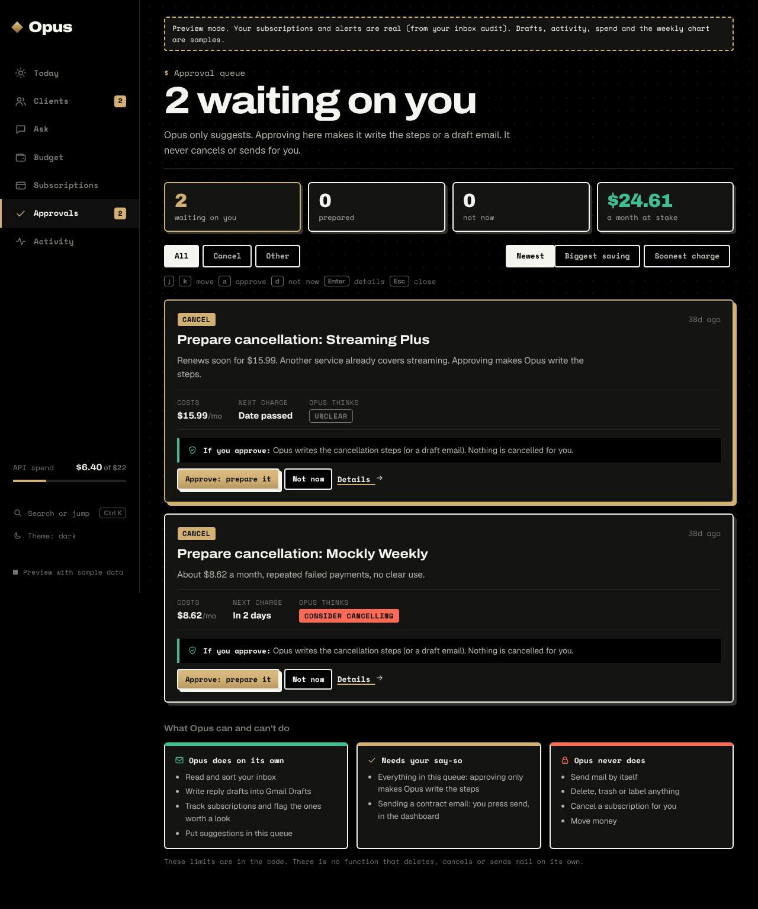
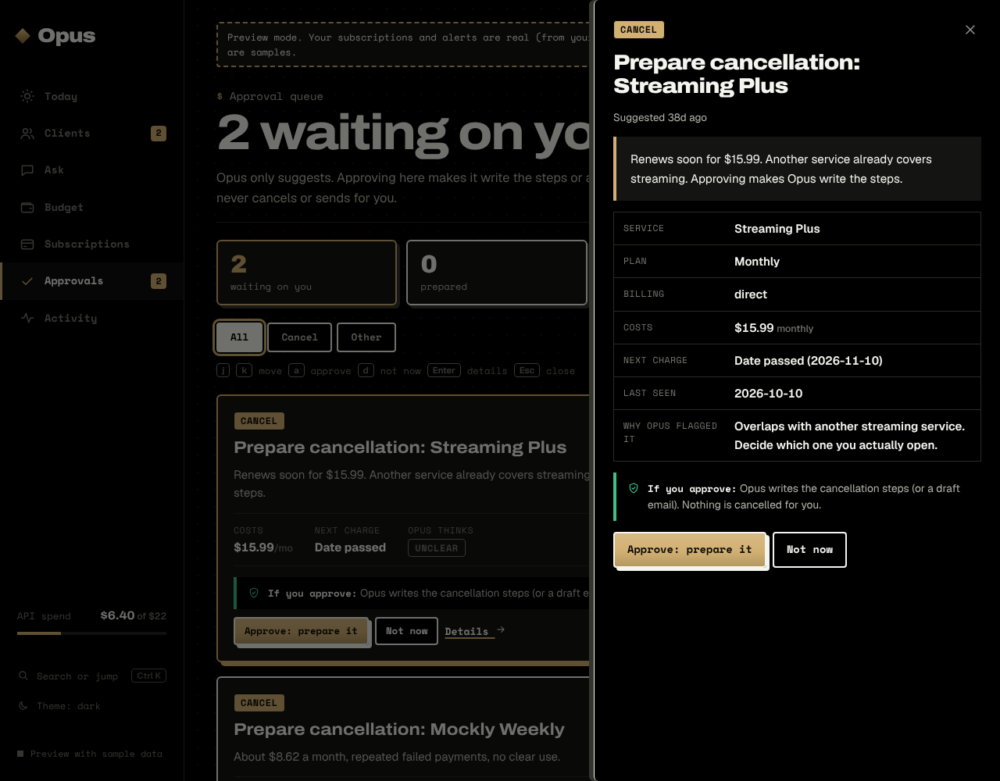
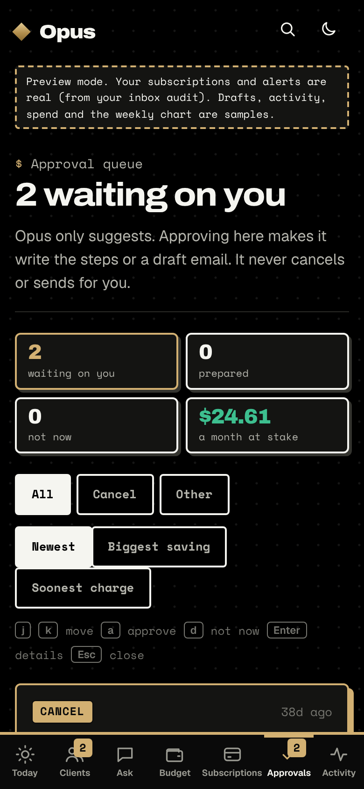

# Approval queue UI

The queue is where anything with consequences waits for a person. Opus only suggests; approving
makes it write the steps or a draft. It never cancels, sends, deletes or moves money.

## What the page shows
1. **Summary strip**: waiting, prepared, dismissed, and how much per month is at stake in the
   waiting items (from the linked subscriptions).
2. **Toolbar**: filter by kind (All, Cancel, Other) and sort (Newest, Biggest saving, Soonest charge).
3. **Cards**: title, why Opus suggested it, the linked subscription's price, next charge and verdict,
   and a plain "if you approve" line saying exactly what will happen (and that nothing is cancelled).
4. **Details drawer**: everything about one item, with Approve and Not now.
5. **Keyboard**: `j`/`k` move, `a` approve, `d` not now, `Enter` details, `Esc` close.
6. **Safety panel**: the three permission tiers (Auto, Needs approval, Never).
7. **History**: what was decided, with the result.

## Not in scope
No new agent endpoints. Approve and dismiss still go through `POST /api/approvals/:id/(approve|dismiss)`.
No undo for a dismissed item, because the agent has no endpoint for it.

## Screens

Mobile: 

## Code
- `dashboard/src/views/Approvals.tsx`: the page, filters, sorting and keyboard handling.
- `dashboard/src/approvals.ts`: pure helpers (kind labels, linked subscription, savings, sorting).
- `dashboard/src/components/`: `ApprovalSummary`, `ApprovalCard`, `ApprovalDrawer`, `SafetyTiers`.
