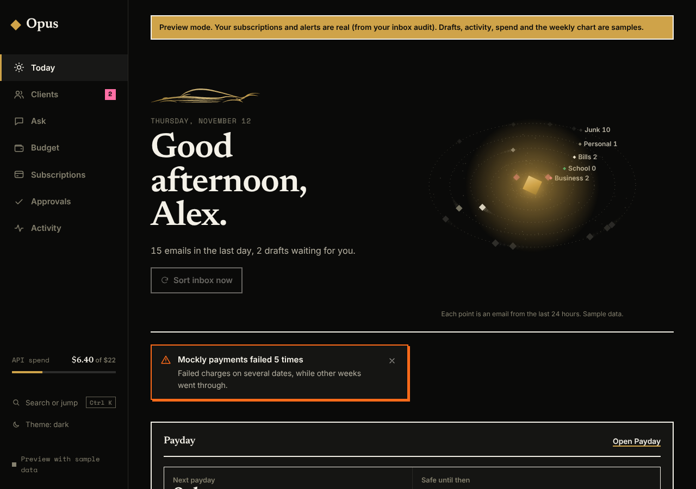
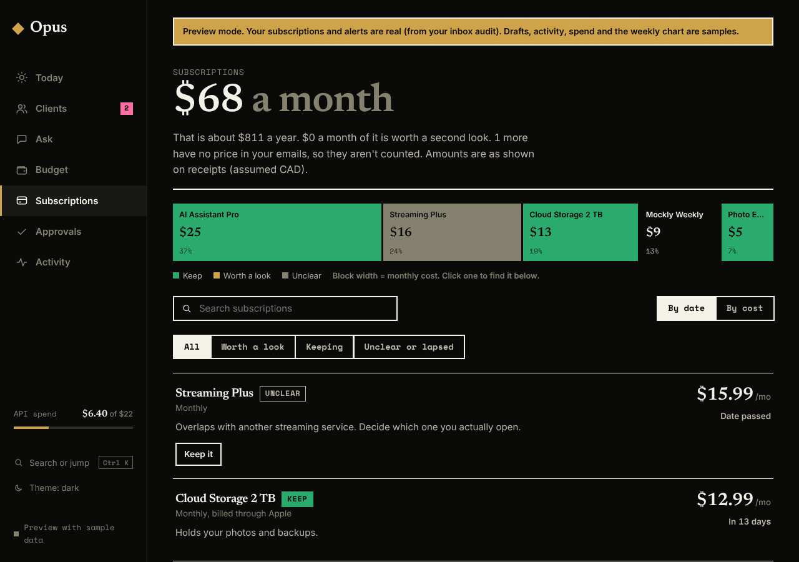
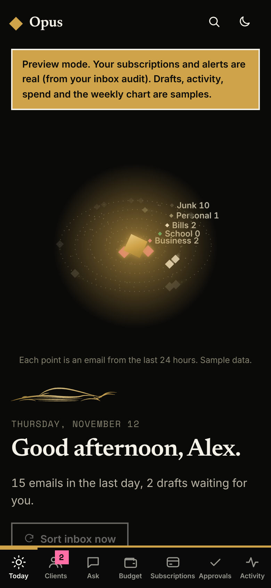
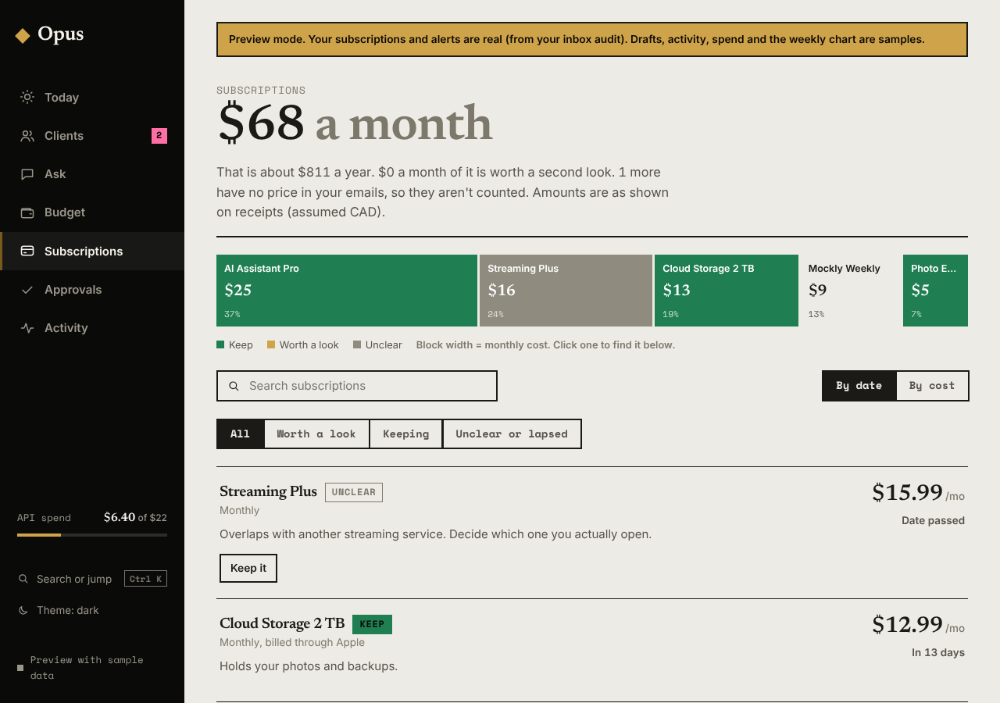

# Obsidian Pop

> Superseded by [opus-style.md](../opus-style.md).

The chosen Opus palette ("G" in the palette options board). A near-black ground with
a real gold as the main action colour, and small, sharp-edged pops that read as signals.

| Token    | Hex       | Used for                |
|----------|-----------|-------------------------|
| ground   | `#0A0A09` | backgrounds             |
| surface  | `#151513` | cards, rows             |
| ink      | `#F4F1E8` | text                    |
| gold     | `#CFA349` | drafts, main action     |
| pink     | `#FF6FA5` | new inquiries           |
| orange   | `#FF6B1A` | budget, warnings        |
| burgundy | `#A3153F` | cancel, destructive     |
| green    | `#2BAA6E` | healthy, synced         |

Rough screen share: ground 62%, surface 14%, ink 10%, gold 5%, pink 3%, orange 3%,
burgundy 2%, green 1%. Black does the heavy lifting, gold marks what needs you.

## Type
- Display and headings: Newsreader 600
- Labels, numbers, badges: Space Mono 700 (uppercase, slight tracking)
- Body: Inter 400-600

## Shapes
- No rounded corners.
- Cards: 2px ink border plus a hard `3px 3px 0` ink offset shadow.
- Status chips: solid fill, ground-coloured text, square.

## Screens
Captured from the dashboard running on its built-in sample data.

| Today (dark) | Subscriptions (dark) |
|---|---|
|  |  |

| Today (mobile) | Subscriptions (light) |
|---|---|
|  |  |

## Where it lives in code
- Tokens: the `:root` blocks at the top of `dashboard/src/styles.css` (light, plus dark via `prefers-color-scheme` and `data-theme="dark"`).
- Fonts: the Google Fonts link in `dashboard/index.html`.
- Type roles and signal colours: the "Obsidian Pop" sections at the bottom of `styles.css`.
