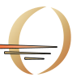
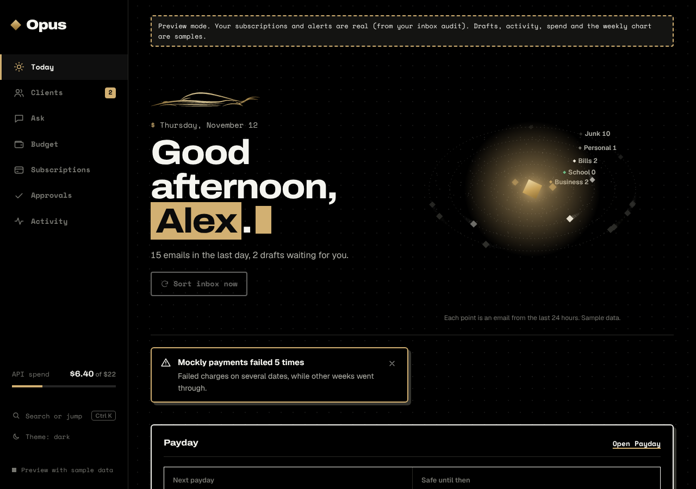
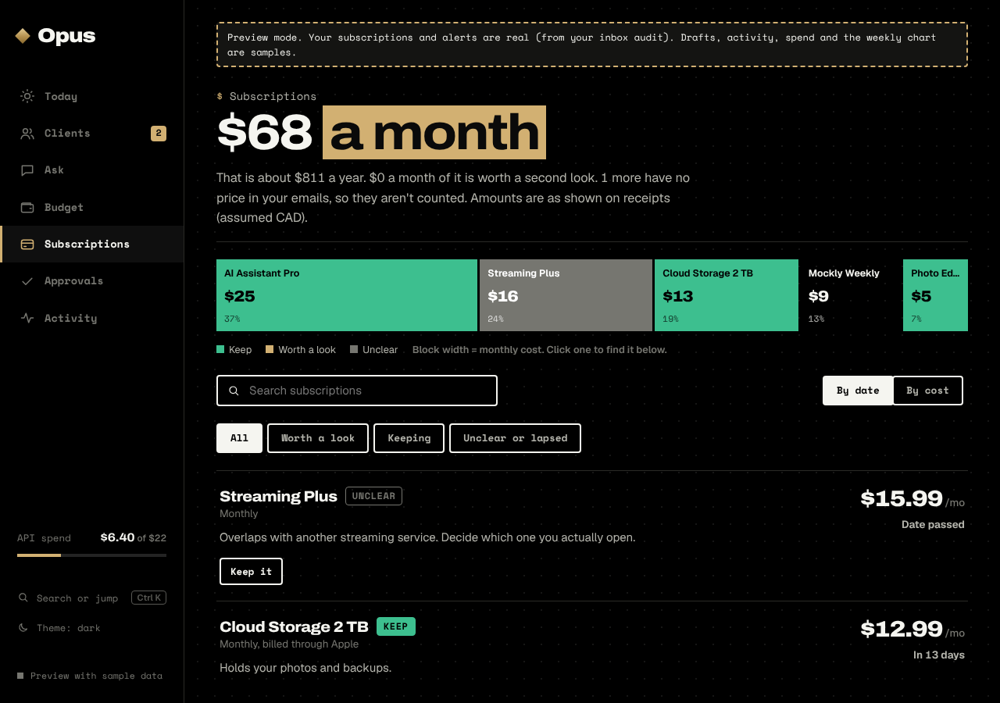
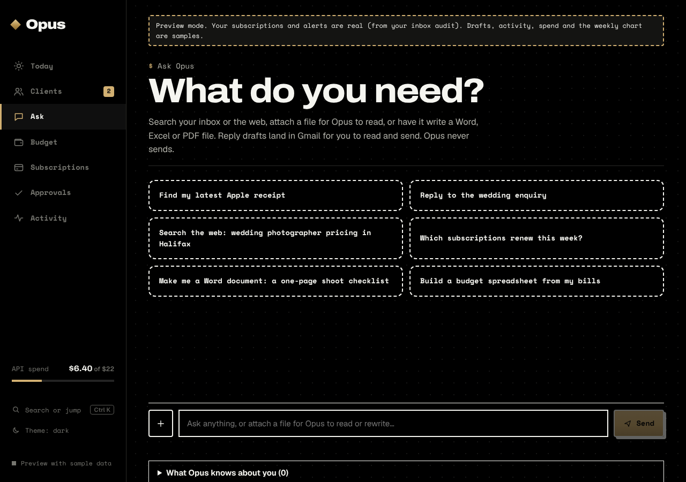
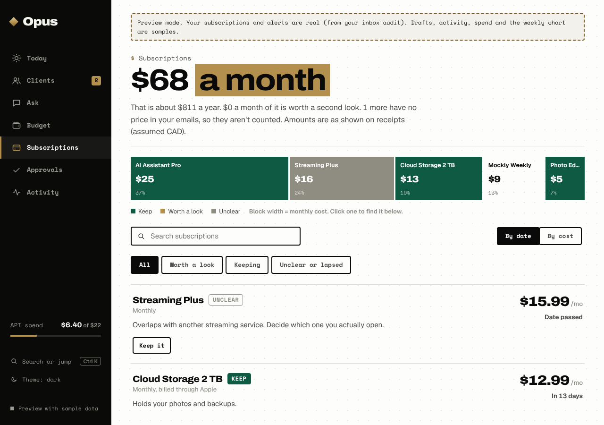
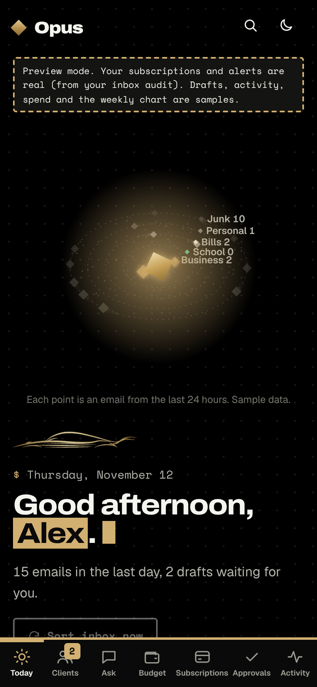

# Opus style (current)

The original Opus palette, with a handful of pieces borrowed from the NitroDrp design.
This replaces the earlier Obsidian Pop and full NitroDrp palettes, which are kept only as history.

## Palette (original, unchanged)
| Token | Light | Dark |
|-------|-------|------|
| paper | `#fdfdfb` | `#000000` |
| paper-2 | `#f3f1ec` | `#141412` |
| ink | `#0a0a0a` | `#f5f5f0` |
| gold | `#b4904e` | `#d2b072` |
| green | `#0e5a43` | `#3dbf8f` |
| bad | `#c8321e` | `#ff6b55` |

Fonts stay Archivo (display) and Geist (body).

## Taken from NitroDrp
- Dot-grid page ground.
- `$ command` eyebrow above each page headline.
- One marked phrase per headline, in gold, plus a blinking cursor.
- Space Mono for buttons, chips, pills, nav and small labels.
- Hard offset shadows on cards, rows and buttons (primary buttons use an ink offset).
- 4px / 6px corner radii.
- Dashed idea cards on the Ask page and a dashed preview notice.

## The O mark
The logo is an "O" drawn like the Opus car: two tapering crescents (thick to thin, like the car's roofline strokes) with level speed lines cutting through the lower third.

- Source: `dashboard/public/logo.svg` (full) and `favicon.svg` (bold, for small sizes). The React version is `OMark.tsx`, the canvas version in the orbit uses the same shapes from `omarkPaths.ts`.
- Icons (favicon, iPhone home screen, Android, maskable) are generated by `dashboard/scripts/make-icons.mjs`.
- The gap around the speed lines is `--mark-knock`, so the mark works on any background.

## Accent colours
Gold and black are still the identity. Four accents add life where colour means something:
| Token | Dark | Light | Used for |
|---|---|---|---|
| `--ember` | `#ff7a45` | `#d9531e` | warnings, the cursor, active nav, Business category |
| `--copper` | `#c0703a` | `#b8692f` | the warm end of gold gradients |
| `--teal` | `#38c9b8` | `#0e8f80` | School category, "prepared" |
| `--violet` | `#8b7cf6` | `#5b4bd1` | Personal category, "unclear" |

## Not taken
NitroDrp's orange, lime and pink. Gold marks what needs you, green means healthy or keep.

## Screens
| Today | Subscriptions |
|---|---|
|  |  |

| Ask | Light theme |
|---|---|
|  |  |

Mobile: 

## Where it lives
Original tokens are at the top of `dashboard/src/styles.css`. Everything borrowed from NitroDrp is in the section "NitroDrp pieces on the original Opus palette" at the bottom.
