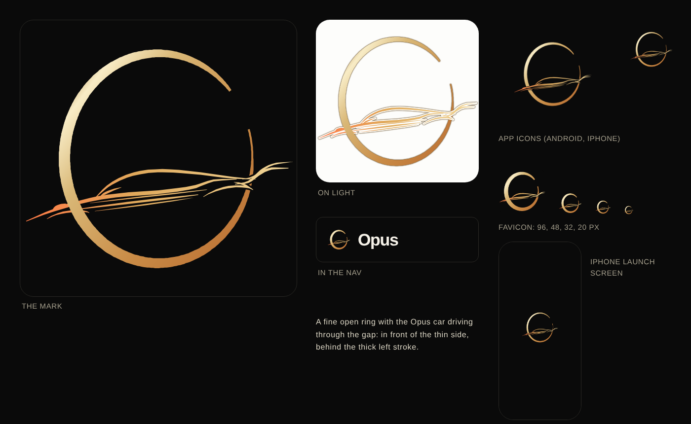
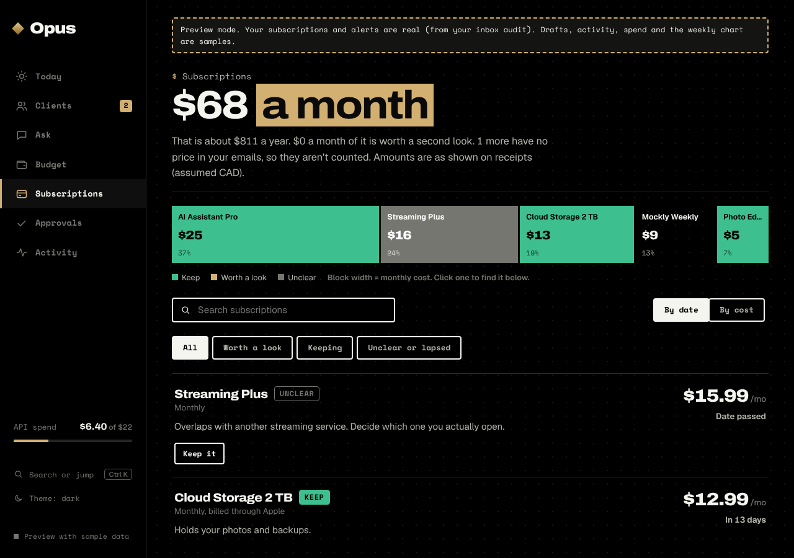
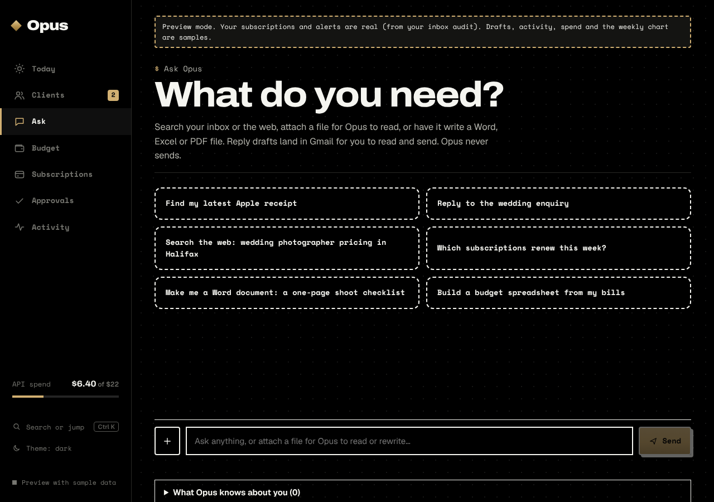
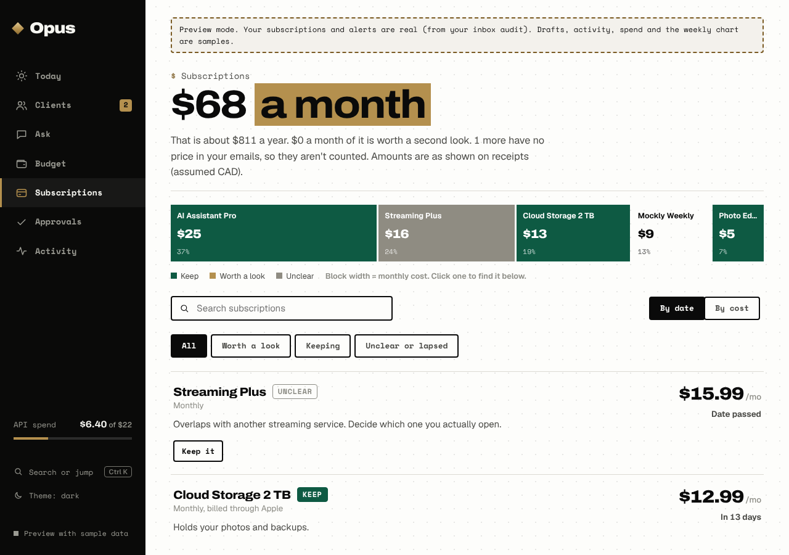

# Opus style (current)

The original Opus palette, with a handful of pieces borrowed from the NitroDrp design.
This replaces the earlier Obsidian Pop and full NitroDrp palettes, which are kept only as history.

## Palette (original, unchanged)
| Token | Light | Dark |
|-------|-------|------|
| paper | `#fdfdfb` | `#000000` |
| paper-2 | `#f3f1ec` | `#141412` |
| ink | `#0a0a0a` | `#f5f5f0` |
| gold | `#b4904e` | `#d2b072` |
| green | `#0e5a43` | `#3dbf8f` |
| bad | `#c8321e` | `#ff6b55` |

Fonts stay Archivo (display) and Geist (body).

## Taken from NitroDrp
- Dot-grid page ground.
- `$ command` eyebrow above each page headline.
- One marked phrase per headline, in gold, plus a blinking cursor.
- Space Mono for buttons, chips, pills, nav and small labels.
- Hard offset shadows on cards, rows and buttons (primary buttons use an ink offset).
- 4px / 6px corner radii.
- Dashed idea cards on the Ask page and a dashed preview notice.

## The mark: the Open ring
The logo is a fine open ring with the Opus car driving through the gap. The ring swells from a hairline to its fullest at the lower left,
like a pen stroke, and leaves a gap at the upper right. The car is the same silhouette used elsewhere in Opus. It passes in front of the ring's
thin side and behind its thick left stroke, so it reads as driving through. Gold with a metallic highlight, and ember orange at the car's tail.

- **It is generated, not hand-drawn.** `dashboard/scripts/make-logo.mjs` draws the ring, takes the car outline from `src/components/CarMark.tsx`,
  and simplifies it so the files stay small. To change the look (ring size, how much it swells, the gap, the car's size and angle),
  edit the numbers at the top of that script and run `node scripts/make-logo.mjs`.
- **Files it writes:** `public/logo.svg` (full detail), `public/favicon.svg` (a heavier version for small sizes) and `src/components/omarkPaths.ts`
  (the shapes and colours used by the React mark and the canvas orbit). Don't edit those by hand.
- **Where it appears:** nav and top bar (`OMark.tsx`, the heavier version), the boot animation (the car drives in), the centre of the Today orbit,
  the favicon, the iPhone home-screen icon and launch screens, and the Android icons.
- **Icons** are regenerated by `node scripts/make-icons.mjs` (needs Playwright). `npm run check:logo` fails if the generated files are out of date,
  an icon is missing or the wrong size, or an SVG contains anything that could run code.
- The car's dark edge uses `--mark-knock`, so it matches the page. On the light theme the mark also gets a hairline dark outline so the pale gold stays visible.

## Accent colours
Gold and black are still the identity. Four accents add life where colour means something:
| Token | Dark | Light | Used for |
|---|---|---|---|
| `--ember` | `#ff7a45` | `#d9531e` | warnings, the cursor, active nav, Business category |
| `--copper` | `#c0703a` | `#b8692f` | the warm end of gold gradients |
| `--teal` | `#38c9b8` | `#0e8f80` | School category, "prepared" |
| `--violet` | `#8b7cf6` | `#5b4bd1` | Personal category, "unclear" |

## Not taken
NitroDrp's orange, lime and pink. Gold marks what needs you, green means healthy or keep.

## Screens
| Today | Subscriptions |
|---|---|
|  |  |

| Ask | Light theme |
|---|---|
|  |  |

Mobile: 

## Where it lives
Original tokens are at the top of `dashboard/src/styles.css`. Everything borrowed from NitroDrp is in the section "NitroDrp pieces on the original Opus palette" at the bottom.
